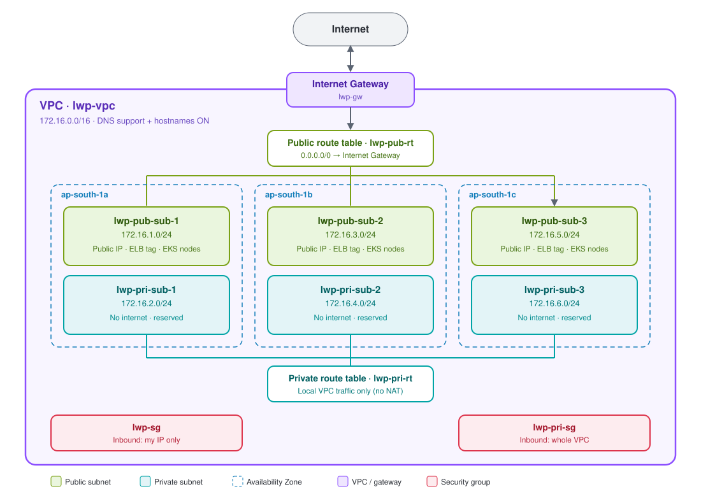
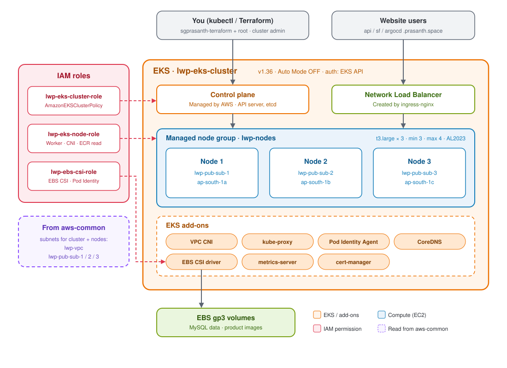

# LWP Seafood Shop: Terraform Architecture

## 1. aws-common: VPC architecture

1. One VPC (`172.16.0.0/16`) is spread across three Availability Zones, so one zone failing does not stop the cluster.
2. Each zone has a public subnet (internet through the Internet Gateway) and a private subnet (no internet, because there is no NAT Gateway).
3. Public subnets give every EC2 a public IP and carry the `kubernetes.io/role/elb` tag, so the ingress load balancer is created there.
4. The two security groups are for your own future servers (`lwp-sg` from your IP, `lwp-pri-sg` from inside the VPC); EKS creates its own.

## 2. aws-eks: EKS architecture

1. AWS runs the control plane; Terraform creates the cluster, three IAM roles, and a managed node group of three `t3.large` nodes, one per public subnet.
2. Nodes sit only in public subnets (found from aws-common through data sources), so each can reach the internet, pull images, and join the cluster.
3. Add-ons provide pod networking, DNS, pod permissions, metrics, SSL certificates, and EBS volumes for MySQL and product images.
4. You manage the cluster as cluster admin (Terraform user + root), and website traffic enters through the ingress-nginx Network Load Balancer.